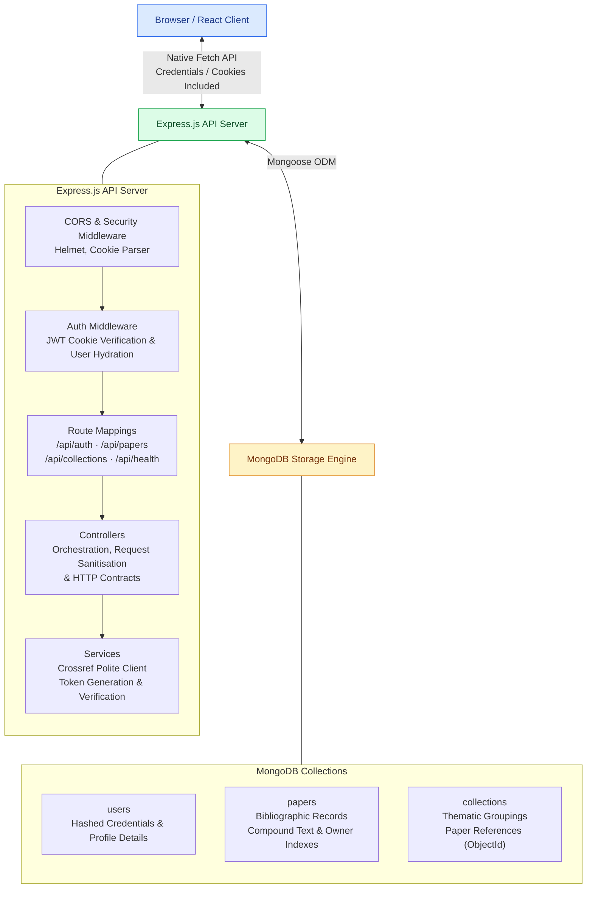

# ResearchForge

**A Collaborative Scholarly Discovery and Research Knowledge Management Platform**

ResearchForge is a full-stack web application designed for researchers, students, and academic teams to discover, organise, curate, and explore academic literature. Built on the **MERN stack** (MongoDB, Express, React, Node.js), it replaces fragmented research workflows with a unified, extensible platform featuring automated bibliographic metadata ingestion via Crossref, personal research library management, full-text search with database-level pagination, thematic collections, and secure authentication.

---

## 1. Implemented Features (MVP)

### 1.1 Secure Authentication & Session Management
- **User Registration & Login**: Validated user signup and credential authentication with display names and unique email enforcement.
- **Robust Security**: Passwords hashed with `bcryptjs` (cost factor 12); authentication delivered via signed JSON Web Tokens (JWT) stored in `HttpOnly`, `SameSite=Lax` cookies to prevent XSS credential theft.
- **Persistent Session Hydration**: Automatic `/api/auth/me` session recovery on application reload with graceful unauthenticated handling.
- **Clean Logout**: Dedicated endpoint and client context to invalidate authentication cookies and clear local state.

### 1.2 Publication Ingestion & Bibliographic Verification
- **Crossref DOI Metadata Retrieval**: Instant metadata lookup via standard DOI strings (e.g., `10.1038/nature14539`), identifying with Crossref polite pool conventions.
- **Metadata Verification Form**: Full pre-commit form to verify and refine titles, authors, publication years, exact dates, venues/journals, publishers, URLs, topic tags, and abstracts.
- **Manual Bibliographic Entry**: Direct entry mode allowing scholars to manually catalog pre-prints, whitepapers, or archival items lacking formal DOIs.
- **Duplicate Prevention**: Scoped DOI uniqueness enforcement per user library (returns HTTP 409 Conflict if duplicate DOI is attempted).
- **Initial Collection Assignment**: Ability to assign publications directly to one or more thematic collections during ingestion with resilient partial-failure feedback.

### 1.3 Personal Research Library & Discovery
- **Strict Owner Isolation**: Multi-tenant data model ensuring each scholar's library and collections are strictly isolated at the database query level (`owner: req.user._id`).
- **Debounced Search**: Responsive full-text search across publication titles, author lists, abstracts, DOIs, and keywords.
- **Database-Level Pagination**: MongoDB-native pagination (`page`, `limit`) preserving exact totals, DOI matches prioritised before text relevance, and stable ordering without loading the entire library into server memory.
- **Tag Filtering**: Rapid client-side topic filtering via interactive tag pills.

### 1.4 Publication Dossiers & Cascade Cleanup
- **Detailed Publication Dossier**: Dedicated view presenting complete bibliographic citations, abstract typography, topic tags, and external DOI resolver links.
- **Cascading Deletion**: Atomic publication deletion with automated `$pull` cleanup removing references from all collections, preventing orphaned document pointers.
- **In-Place Updates**: Editable publication records with immediate reactive UI reflection.

### 1.5 Thematic Collections Management
- **Flexible Topic Grouping**: Create and describe custom research folders/dossiers (e.g., "Transformer Architectures", "Quantum Computing").
- **Unique Collection Names**: Scoped uniqueness per researcher preventing duplicate folder naming.
- **Dynamic Membership**: Add and remove publications from collections with reactive state updates.
- **Sidebar Integration**: Pinned collection shortcuts in the global navigation displaying real-time publication counts.

---

## 2. Technology Stack

| Layer | Technology | Version / Specification | Role |
| :--- | :--- | :--- | :--- |
| **Frontend** | React | 19.x | Component-driven user interface |
| **Tooling & Build** | Vite | 6.x | Fast development server and production bundler |
| **Styling** | Tailwind CSS | 4.x | Utility-first responsive design system |
| **Routing** | React Router | 7.x | Client-side routing and protected routes |
| **Icons** | Lucide React | Latest | Clean, accessible SVG iconography |
| **Backend Runtime**| Node.js | 22 LTS (ES Modules) | High-performance server environment |
| **API Server** | Express.js | 5.x | RESTful routing, middleware, and request handling |
| **Database** | MongoDB | 7.x / 8.x | Document-oriented database for scholarly records |
| **ODM** | Mongoose | 9.x | Schemas, validation, indexes, and middleware |
| **Metadata Sources**| Crossref & OpenAlex REST APIs | v1 | Primary Crossref resolution with OpenAlex secondary enrichment |
| **Testing** | Node Test Runner / Vitest | Built-in / 5.x | Comprehensive backend and frontend test suites |

---

## 3. High-Level Architecture

ResearchForge follows a modular, layered architecture with a strict separation of concerns:



- **Routes**: Handle URL mapping, route parameters, and middleware attachment only.
- **Controllers**: Orchestrate request parsing, input sanitisation, service execution, and HTTP response formatting.
- **Models**: Enforce Mongoose schemas, compound indexes (e.g., text search indexes with owner scoping), and data-layer invariants.
- **Frontend Contexts**: Centralise reactive authentication (`AuthContext`) and library/collection operations (`LibraryContext`).

---

## 4. Project Directory Structure

```text
fsad-pbl/
├── client/                         # React frontend client
│   ├── src/
│   │   ├── context/                # Global React contexts (AuthContext, LibraryContext)
│   │   ├── layouts/                # Base layouts (AppLayout with sidebar & user profile)
│   │   ├── pages/                  # Page components (Dashboard, Library, Import, Collections, Dossier)
│   │   │   └── __tests__/          # Page-level integration tests
│   │   ├── services/               # Native-fetch API abstractions (authApi, paperApi, collectionApi)
│   │   ├── test/                   # Vitest setup and testing utilities
│   │   ├── App.jsx                 # Route configurations and protected route wrappers
│   │   └── main.jsx                # React application entry point
│   ├── package.json                # Frontend dependencies and test scripts
│   └── vite.config.js              # Vite and Vitest configuration
│
├── server/                         # Express.js backend server
│   ├── src/
│   │   ├── config/                 # Environment validation, database bootstrapper, CORS
│   │   ├── controllers/            # Request handlers (auth, papers, collections)
│   │   ├── middleware/             # Auth verification, error handling, request logger
│   │   ├── models/                 # Mongoose models (User, Paper, Collection)
│   │   ├── routes/                 # REST endpoint routers
│   │   ├── services/               # Business logic (Crossref client, token service)
│   │   ├── app.js                  # Express application setup
│   │   └── server.js               # HTTP server bootstrap entry
│   ├── tests/                      # Unit and integration test suites
│   │   ├── models/                 # Mongoose schema and index tests
│   │   ├── routes/                 # API endpoint integration tests (MongoDB Memory Server)
│   │   └── services/               # Service unit tests (Crossref, JWT)
│   └── package.json                # Backend dependencies and test scripts
│
├── scripts/
│   └── dev.js                      # Concurrent development orchestrator
│
├── .env.example                    # Environment variable configuration template
├── package.json                    # Root workspace convenience commands
├── LICENSE                         # Apache 2.0 License
└── README.md                       # System documentation
```

---

## 5. Getting Started

### 5.1 Prerequisites
- **Node.js**: Version 22 LTS or higher.
- **npm**: Version 10 or higher.
- **MongoDB**: A running local MongoDB instance (`mongod`) or a MongoDB Atlas connection string.

### 5.2 Fresh Clone Installation
Clone the repository and install all dependencies for both the frontend and backend using the root setup command:

```bash
git clone https://github.com/Abhi-A-S/fsad-pbl.git
cd fsad-pbl

# Install dependencies for both server and client in one step:
npm run install:all
```

*(Alternatively, you can run `npm install --prefix server && npm install --prefix client`)*

### 5.3 Environment Configuration
Copy the `.env.example` template to `.env` in the repository root:

```bash
cp .env.example .env
```

Configure the environment variables according to your local setup:

| Variable | Description | Default / Example |
| :--- | :--- | :--- |
| `NODE_ENV` | Application environment (`development`, `production`, `test`) | `development` |
| `PORT` | Port for the Express backend server | `5000` |
| `CLIENT_URL` | Origin of the frontend client for CORS configuration | `http://localhost:5173` |
| `MONGODB_URI`| Connection URI for MongoDB (use `127.0.0.1` locally) | `mongodb://127.0.0.1:27017/researchforge` |
| `JWT_SECRET` | Secret key used to sign and verify session tokens | *(Generate a random 64-char string)* |
| `JWT_EXPIRES_IN` | Token expiration period | `1d` |
| `AUTH_COOKIE_NAME`| Name of the session cookie | `rf_token` |
| `CROSSREF_MAILTO` | Contact email for the Crossref polite API pool | `scholar@institution.edu` |

> **Security Note:** In production, generate a secure random secret using:
> ```bash
> node -e "console.log(require('crypto').randomBytes(64).toString('hex'))"
> ```

### 5.4 Starting MongoDB
Ensure your MongoDB service is running before starting the backend:

```bash
# macOS (Homebrew)
brew services start mongodb/brew/mongodb-community

# Linux (systemd)
sudo systemctl start mongod

# Direct binary
mongod --dbpath /data/db
```

### 5.5 Starting the Development Environment
Run both backend and frontend development servers concurrently with a single command from the project root:

```bash
npm run dev
```

- **Frontend Client**: [http://localhost:5173](http://localhost:5173)
- **Backend API Server**: [http://localhost:5000](http://localhost:5000)
- **API Health Check**: [http://localhost:5000/api/health](http://localhost:5000/api/health)

---

## 6. Testing & Quality Assurance

ResearchForge maintains high test coverage across both the backend and frontend.

### 6.1 Running All Tests
To execute both test suites sequentially:
```bash
npm test
```

### 6.2 Running Backend Tests
The backend test suite uses Node.js's native test runner (`node:test`) and `mongodb-memory-server` to run fully isolated unit and integration tests:
```bash
npm run test:server
# Or directly from server directory:
npm test --prefix server
```

### 6.3 Running Frontend Tests
The frontend test suite uses Vitest, React Testing Library, and jsdom to verify component rendering, user interactions, and state flows:
```bash
npm run test:client
# Or directly from client directory:
npm test --prefix client
```

### 6.4 Production Build
Verify that the React frontend builds cleanly for production deployment:
```bash
npm run build
```

---

## 7. Main API Endpoints

### Authentication (`/api/auth`)
| Method | Endpoint | Description | Auth Required |
| :--- | :--- | :--- | :---: |
| `POST` | `/api/auth/register` | Register a new user account | No |
| `POST` | `/api/auth/login` | Authenticate credentials and set session cookie | No |
| `GET` | `/api/auth/me` | Fetch currently authenticated user session | Yes |
| `POST` | `/api/auth/logout` | Invalidate and clear session cookie | Yes |

### Publications (`/api/papers`)
| Method | Endpoint | Description | Auth Required |
| :--- | :--- | :--- | :---: |
| `GET` | `/api/papers/lookup` | Resolve metadata by DOI via Crossref with OpenAlex automated enrichment (`?doi=...`) | Yes |
| `GET` | `/api/papers/:id/enrich-suggestions` | Retrieve OpenAlex metadata enrichment suggestions for an existing paper (`?openAlexId=...`) | Yes |
| `POST` | `/api/papers` | Save a new publication record to user library | Yes |
| `GET` | `/api/papers` | List user publications with database pagination | Yes |
| `GET` | `/api/papers/search` | Search user library by keyword with pagination | Yes |
| `GET` | `/api/papers/:id` | Retrieve a publication by ID | Yes |
| `PUT` | `/api/papers/:id` | Update publication metadata | Yes |
| `DELETE`| `/api/papers/:id` | Delete publication and cascade remove from collections | Yes |

### Collections (`/api/collections`)
| Method | Endpoint | Description | Auth Required |
| :--- | :--- | :--- | :---: |
| `GET` | `/api/collections` | List all collections belonging to authenticated user | Yes |
| `POST` | `/api/collections` | Create a new research collection | Yes |
| `POST` | `/api/collections/:id/papers` | Add a publication to a collection | Yes |
| `DELETE`| `/api/collections/:id/papers/:paperId` | Remove a publication from a collection | Yes |

### Health Check (`/api/health`)
| Method | Endpoint | Description | Auth Required |
| :--- | :--- | :--- | :---: |
| `GET` | `/api/health` | Service uptime and status check | No |

---

## 8. Current Scope & Future Roadmap

### Current Scope (Extended MVP)
- **Single-User Libraries**: Research libraries and collections are strictly isolated to the owning user; collaborative team sharing is deferred to future phases.
- **Bibliographic Ingestion & Enrichment**: Supports primary Crossref DOI metadata lookup, automatic secondary OpenAlex enrichment for missing fields (abstracts, venue, dates), manual entry without DOI, and manual inline OpenAlex enrichment on existing library papers with candidate disambiguation and non-destructive diff reviews.
- **Document Management**: Document attachments and PDF viewing are planned for future phases.
- **External Citations**: Citation graphs and reference tracking are pending sidecar microservices.

### Future Roadmap
1. **Collaborative Workspaces & RBAC**: Shared research dossiers with Owner, Editor, and Viewer permissions.
2. **Document Management & PDF Viewer**: In-browser PDF viewing, full-text parsing, and highlight extraction.
3. **Scholarly Annotations**: Threaded margin notes, rich-text commentary, and markdown synthesis.
4. **Python AI/NLP Sidecar Service**: Semantic vector search, automated literature summarisation, and citation network visualization.

---

## 9. License

This project is licensed under the Apache License 2.0. See the [LICENSE](LICENSE) file for details.
